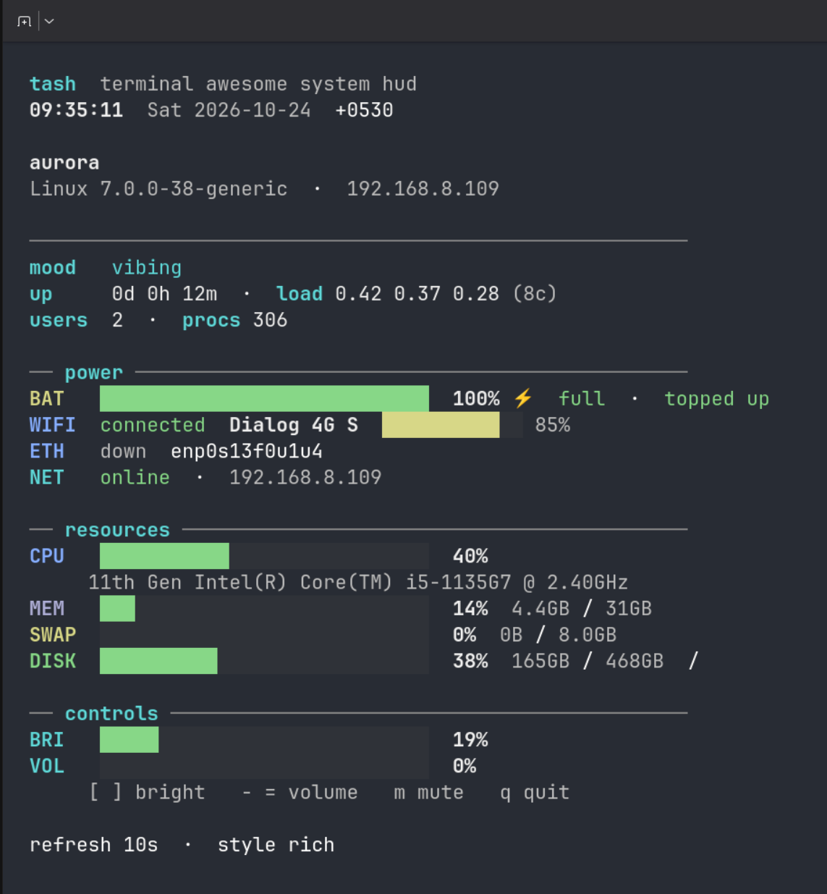

# tash

**T**erminal **A**wesome **S**ystem **H**UD

> Using `tash` makes you awesome.  
> Your friends may not understand why.  
> Show them the mood line. Or don’t. Mystery is free.

```
  ████████╗ █████╗ ███████╗██╗  ██╗
  ╚══██╔══╝██╔══██╗██╔════╝██║  ██║
     ██║   ███████║███████╗███████║
     ██║   ██╔══██║╚════██║██╔══██║
     ██║   ██║  ██║███████║██║  ██║
     ╚═╝   ╚═╝  ╚═╝╚══════╝╚═╝  ╚═╝
```

## The story

You installed Debian minimal for purity. No wallpaper. No widgets. No little battery face in the corner — only a cursor, blinking like it knew something you didn’t.

Your friends asked how it was going.  
You said “closer to the metal.”  
The metal did not RSVP.

One night the fans rose to takeoff. Was it Chrome? A compile? Divine intervention with jokes? You pressed Fn+brightness. Nothing. Fn+volume. Still nothing. You opened `top`, then `htop`, then another terminal for moral support. Wi‑Fi was either connected or rehearsing the role.

A friend leaned in the doorway, took in the scene — five windows, one laptop, zero answers — and said, kindly:

“You’re doing this the hard way. Run `tash`.”

You typed `./tash` as if the room might grade you.

The screen cleared. Teal settled in. Bars drew themselves. Mood: *mildly concerned*. You closed one Electron window you’d been calling “research.” Mood: *vibing*. Battery: **81%** · **2h 14m left**. Network: yes, actually. Later, with `tash-hotkeys`, the Fn row came home from a lunch that started when the desktop left town.

Your friend smiled the small smile of someone whose work here was done.

You were not famous. You were not fluent in Japanese.  
You were **awesome** — the soft kind, the kind that refreshes instead of reboots.

Weeks later, you will stand in someone else’s doorway and say the same line.  
That is how friends pass it on.

## What `tash` is

A live system HUD for people who would rather know than reboot “just to see.”

- **Mood** — `vibing` through `panicking quietly`
- **Battery** — percent and time left (or to full)
- **Clock, Wi‑Fi, ethernet, online / offline**
- **CPU, memory, swap, disk** — honest bars
- **Brightness & volume** — in the HUD; Fn keys on bare Debian via `tash-hotkeys`

## Quick start

```bash
chmod +x tash tash-ctl tash-hotkeys
./tash
```

| Command | Meaning |
|---------|---------|
| `./tash` | Live HUD — onset of awesome |
| `./tash --once` | One frame to show a friend |
| `tash-ctl status` | Brightness + volume, quietly |
| `tash-ctl brightness up` | More light |
| `tash-ctl volume down` | More peace (neighbors rejoice) |
| `tash-hotkeys` | Fn keys, back on duty |

## Keyboard

| Key | Action |
|-----|--------|
| `[` `]` | Brightness down / up |
| `-` `=` | Volume down / up |
| `m` | Mute |
| `q` | Quit (awesome stays) |

### Fn keys on Debian minimal (no desktop)

No desktop means no free hotkey fairy. Keys arrive on `/dev/input/event*` (on Dell Latitude, often **Dell WMI hotkeys**). `tash-hotkeys` listens.

```bash
sudo ./contrib/debian-minimal/install.sh
# log out / back in (or reboot)
```

Loads `dell_wmi`, stops logind from swallowing brightness keys, installs udev rules, runs `tash-hotkeys.service`.

```bash
tash-ctl brightness up
sudo tash-hotkeys --list
sudo tash-hotkeys --test
```

**Dell Latitude 5480:** BIOS → Function Key Behavior, or **Fn+Esc**. Unknown `code=N`?

```bash
sudo systemctl edit tash-hotkeys
# [Service]
# Environment=TASH_EXTRA_KEYS=N:brightness:up,M:brightness:down
sudo systemctl restart tash-hotkeys
```

## `tash-ctl`

```bash
tash-ctl brightness get|up|down|set 40
tash-ctl volume     get|up|down|set 30|mute|unmute|toggle
tash-ctl status
```

**PipeWire** → **PulseAudio** → **ALSA**.

## Debian minimal (manual)

```bash
sudo apt-get install -y alsa-utils python3
sudo usermod -aG video,input,audio "$USER"
# re-login
sudo cp contrib/debian-minimal/99-tash-backlight.rules /etc/udev/rules.d/
sudo udevadm control --reload-rules && sudo udevadm trigger -s backlight
```

Or triggerhappy — see `contrib/debian-minimal/`.

## Requirements

- `bash`
- Linux for brightness / Fn (macOS: HUD works)
- Styles: **rich** · **minimal** (`TERM=linux`) · **ascii**  
  (`TASH_STYLE=minimal` if the console gets mysterious)
- Fn keys: `/dev/input/event*` + `python3` (or triggerhappy)

## Moods

| Mood | What you do |
|------|-------------|
| living its best life | Screenshot. Show a friend. Softly. |
| vibing | Nothing. That’s the point. |
| mildly concerned | Close a tab. Any tab. Prefer the heavy one. |
| panicking quietly | Tabs down. Walk. Return awesome. |

## FAQ

**Do people become awesome by using `tash`?**  
Yes. Then they tell their friends. Then their friends stand in doorways. It’s a cycle.

**Why don’t Fn keys work inside `tash` alone?**  
They skip stdin and wait on evdev. Run `tash-hotkeys`.

**Brightness denied?**  
Join `video`, reload udev, log in again.

**No volume?**  
`alsa-utils` + `alsamixer`. Be the friend who knows.

**Vs `htop`?**  
`htop` counts processes. `tash` is the overview — battery, network, backlight — and you looking like you meant to open the laptop.



## License

MIT. Share it with friends. Especially the ones still rebooting.

---

*For terminals. For laptops. For friends who say “run `tash`” and mean it.*
